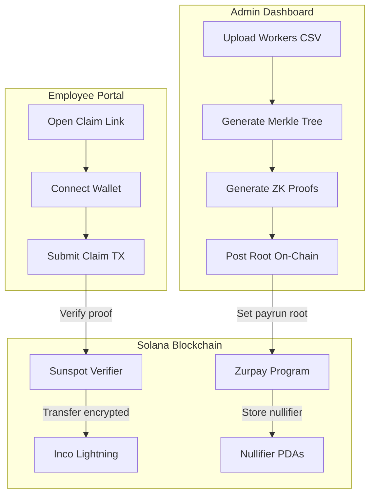

# How It Works

Zurpay combines three core technologies to achieve confidential payroll:

1. **Noir ZK Circuits** — Prove claim eligibility without revealing identity
2. **Inco Lightning** — Encrypt transfer amounts using FHE
3. **Merkle Trees** — Commit to payroll data without exposing it

## Architecture Overview



## The Claim Flow

### Step 1: Admin Creates Payrun

Admin uploads a CSV with worker emails and amounts:

```csv
email,amount
alice@company.com,5000000000
bob@company.com,3500000000
```

The system generates:

- **Merkle tree** of all claims
- **ZK proof** for each employee
- **Encrypted amount** (Inco ciphertext)

### Step 2: Root Posted On-Chain

Only the **32-byte Merkle root** goes on-chain. The employee list stays private.

```rust
pub struct Payrun {
    pub merkle_root: [u8; 32],
    pub org_id: Pubkey,
    pub claims_opened: bool,
    pub nullifier_count: u64,
}
```

### Step 3: Employee Claims

Employee opens their claim link and submits a transaction containing:

| Data             | Purpose                           |
| ---------------- | --------------------------------- |
| ZK Proof         | Proves they're in the Merkle tree |
| Nullifier        | Prevents double-claiming          |
| Encrypted Amount | Inco ciphertext of salary         |

### Step 4: On-Chain Verification

The Zurpay program:

1. **Verifies ZK proof** via Sunspot verifier
2. **Checks nullifier** isn't already used
3. **Stores nullifier** to prevent replay
4. **Executes Inco transfer** of encrypted amount

## Zero-Knowledge Proof

The Noir circuit proves:

```
"I know a (secret, commitment) pair such that:
  - sha256(secret || commitment) is a leaf in the Merkle tree
  - The nullifier is derived correctly from my secret
  - The payout address matches my wallet
  - The encrypted amount matches my salary commitment"
```

### Public Inputs (192 bytes)

| Field              | Offset | Size | Description              |
| ------------------ | ------ | ---- | ------------------------ |
| merkle_root        | 0      | 32   | Payrun Merkle root       |
| nullifier          | 32     | 32   | Unique claim identifier  |
| payout_pubkey_hash | 64     | 32   | Hash of recipient wallet |
| org_id             | 96     | 32   | Organization identifier  |
| salary_commitment  | 128    | 32   | Commitment to salary     |
| ciphertext_hash    | 160    | 32   | Hash of encrypted amount |

### Why This Works

- **merkle_root**: Binds proof to specific payrun
- **nullifier**: Derived from secret, prevents double-claim
- **payout_pubkey_hash**: Binds proof to claimer's wallet
- **ciphertext_hash**: Binds proof to specific encrypted amount (prevents substitution)

## Inco Lightning (FHE)

Inco Lightning uses **Fully Homomorphic Encryption** to encrypt token amounts on-chain.

### What's Encrypted

| Visible On-Chain      | Hidden (Encrypted) |
| --------------------- | ------------------ |
| Sender address        | Transfer amount    |
| Recipient address     | Account balances   |
| Transaction signature |                    |

### How It Works

1. Amount encrypted client-side using Inco SDK
2. Ciphertext included in transaction
3. Inco program updates encrypted balances
4. Only account owner can decrypt their balance

```typescript
// Encrypting amount client-side
const encryptedAmount = await incoClient.encrypt(amount, recipientPubkey);
```

## Merkle Tree Structure

Each leaf in the Merkle tree:

```
leaf = sha256(
  payrun_id ||
  employee_commitment ||
  salary_commitment ||
  ciphertext_hash ||
  payout_pubkey_hash
)
```

### Privacy Properties

| Property                 | How Achieved                  |
| ------------------------ | ----------------------------- |
| Employee list hidden     | Only root on-chain            |
| Salary hidden            | Encrypted in Inco ciphertext  |
| Claim eligibility proven | ZK proof of Merkle membership |
| Double-claim prevented   | Nullifier stored on-chain     |

## Payment Requests (P2P)

Zurpay also supports peer-to-peer confidential payments:

1. **Requester** creates payment request (amount + memo)
2. **System** generates shareable link
3. **Payer** opens link, sees request details
4. **Payer** executes Inco confidential transfer
5. **Amount hidden** — only parties know the value

This enables confidential contractor payments, reimbursements, and invoicing.

## Security Considerations

### What's Cryptographically Enforced

- ZK proofs verified on-chain (Sunspot verifier)
- Nullifiers prevent double-claiming
- Inco encryption hides amounts
- Wallet binding via payout_pubkey_hash

### What Requires Trust

- Payroll builder service (generates proofs)
- Claim link distribution (email delivery)
- Inco network (FHE computation)

See [Trust Model](/resources/trust-model) for detailed analysis.
