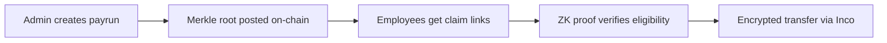

# Introduction to Zurpay

**Zurpay** is a **confidential payroll protocol** enabling **private salary payments** on Solana. Amounts are encrypted using Inco Lightning, and claim eligibility is verified with zero-knowledge proofs.

:::info What is Zurpay?
Zurpay solves the "public payroll" problem on blockchain. Traditional on-chain payments expose salary amounts, payment schedules, and organizational burn rate to anyone watching the chain. Zurpay keeps all of this private while maintaining the benefits of blockchain settlement.
:::

## The Problem

On-chain payroll today is "public payroll":

- Anyone can infer salaries and org burn rate
- Employees can see who got how much
- Treasury visibility leaks runway and strategy
- Payment timing reveals business patterns

## The Solution

Zurpay makes payroll feel like Stripe or Mercury but with:

| Feature                     | Technology                        |
| --------------------------- | --------------------------------- |
| **Encrypted Amounts**       | Inco Lightning (FHE)              |
| **Claim Verification**      | Noir ZK proofs + Sunspot verifier |
| **Settlement**              | Solana (fast, cheap)              |
| **Double-Claim Prevention** | Nullifiers stored on-chain        |

## Key Features

| Feature                   | Description                                                  |
| ------------------------- | ------------------------------------------------------------ |
| **Zero-Knowledge Proofs** | Employees prove claim eligibility without revealing identity |
| **Encrypted Transfers**   | Amounts hidden on-chain using Fully Homomorphic Encryption   |
| **Non-Custodial**         | Treasury funds controlled by organization wallet             |
| **Tokenized Claims**      | Claim links are unguessable, not wallet-based                |
| **Merkle Commitments**    | Only the root is on-chain, not employee list                 |
| **Payment Requests**      | P2P confidential payments between any wallets                |

## How It Works (High Level)

1. **Admin** uploads a CSV of workers and amounts
2. **System** generates Merkle tree and ZK proofs for each claim
3. **Admin** posts only the Merkle root on-chain
4. **Employees** receive tokenized claim links via email
5. **Employee** submits claim → ZK proof verified on-chain
6. **Inco Lightning** executes encrypted transfer

## Network Status

:::tip Devnet Live
Zurpay is currently deployed on **Solana Devnet** using **Inco Lightning** for confidential transfers. All features are fully functional for testing.
:::

**Current deployment:**

- **Solana Devnet** — Live and operational
- **Mainnet** — Coming after hackathon

## Getting Started

Ready to start using Zurpay? Follow these guides:

- [How It Works](/how-it-works) — Deep dive into the architecture
- [Admin Setup](/user-guide/admin-setup) — Initialize your organization
- [Create Payrun](/user-guide/create-payrun) — Run your first confidential payroll
- [Employee Claims](/user-guide/employee-claims) — How employees claim payments

---

:::warning Devnet = Experimental
Zurpay is currently on **devnet** — this is experimental software for the Solana Privacy Hackathon 2026. Review the [Trust Model](/resources/trust-model) to understand what is cryptographically enforced vs. what requires trust.
:::
